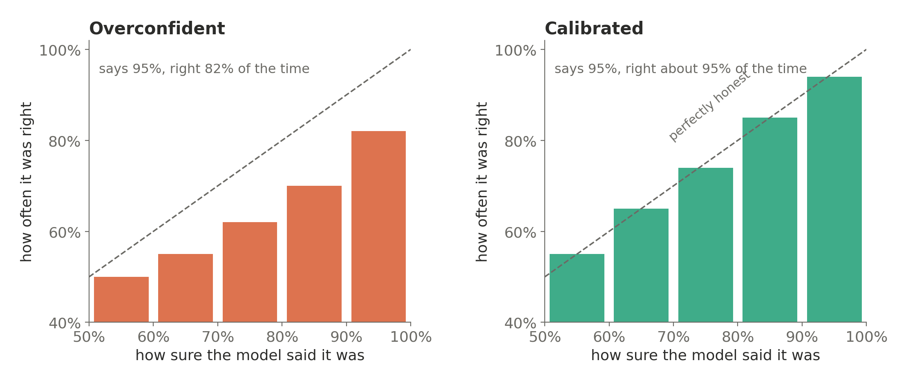
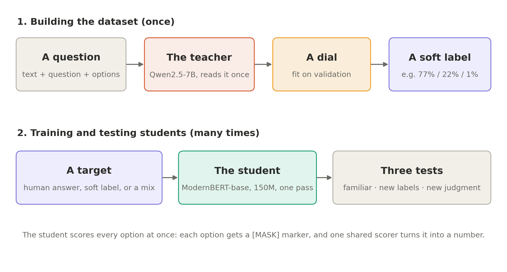
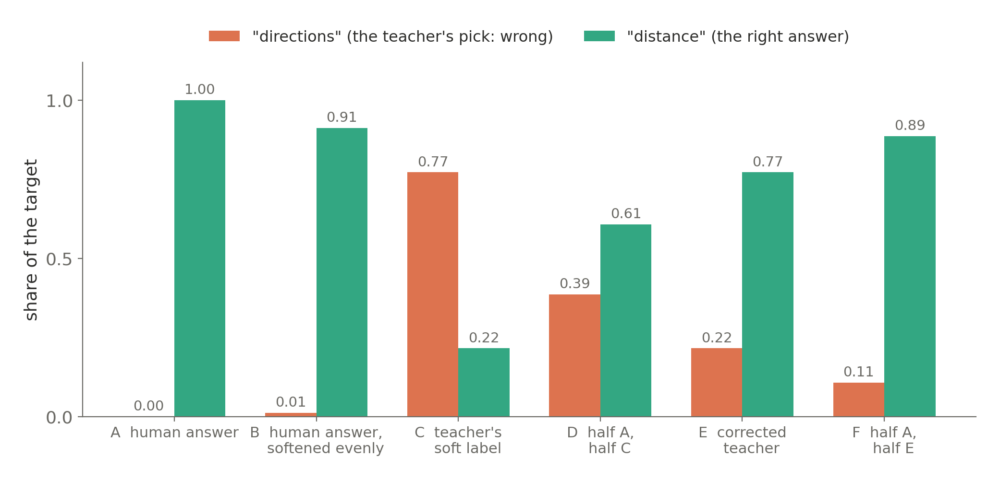
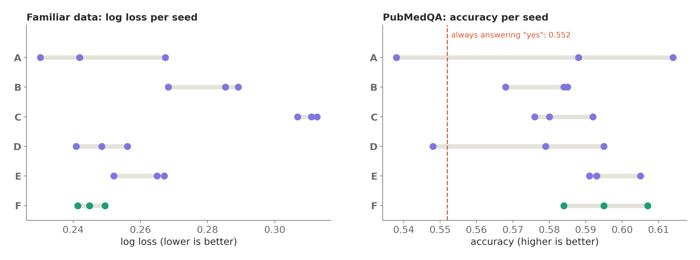
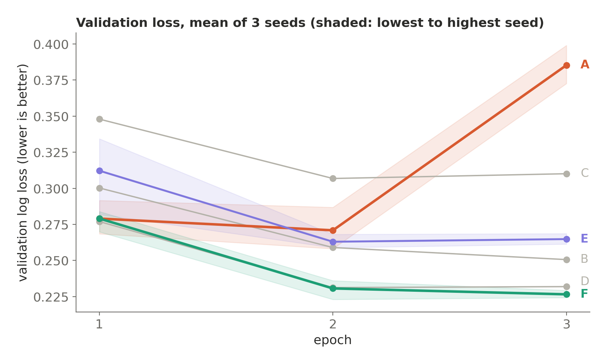
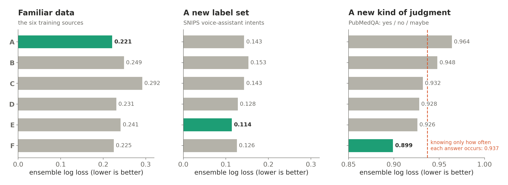
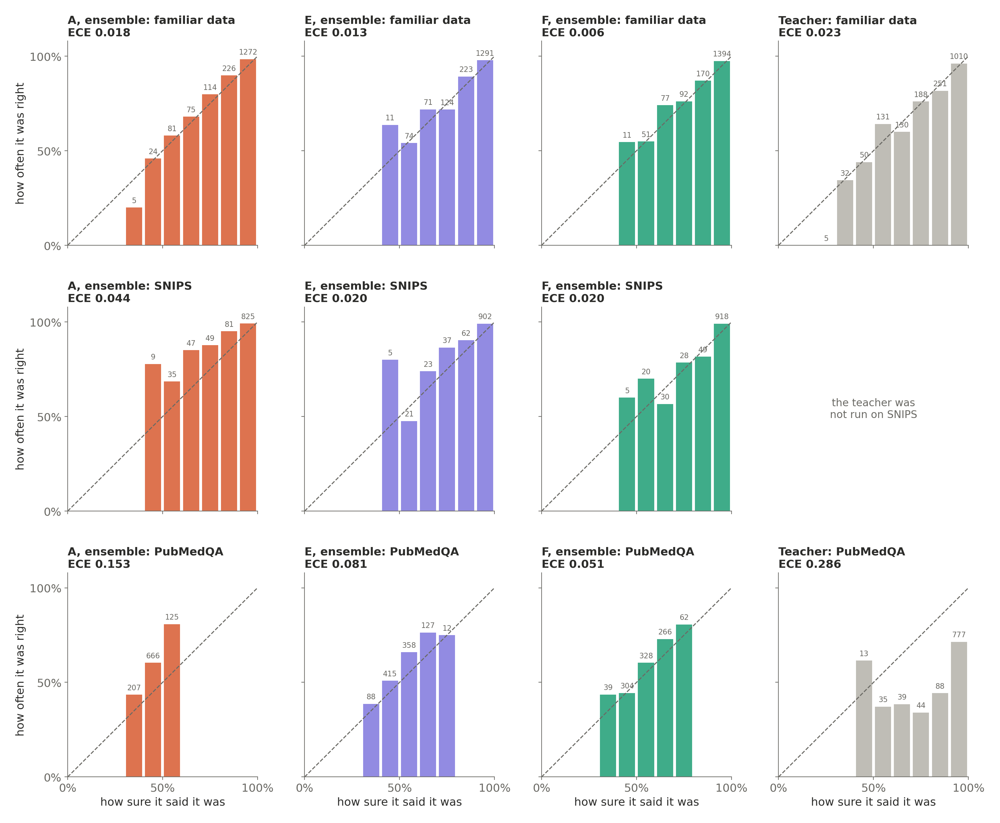
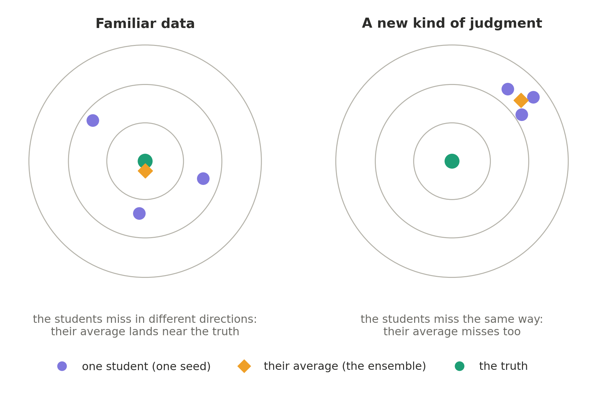

_I trained more than 30 small classifiers to learn not just the right answer, but how much to trust it. The first result was a no. Here's what it took to get a yes, and where honesty still isn't enough._

---

## "90% sure" should mean something

If a model says it is 90% confident, then across many predictions made at that confidence level, it should be right about 9 times out of 10.

That sounds obvious, but a lot of real systems depend on it. A support tool that routes tickets automatically when it's confident, and sends the rest to a human. A moderation filter that only acts above a threshold. A pipeline that asks a bigger, more expensive model only when a small one is unsure. All of them treat the model's confidence as a promise.

Most models break that promise. Modern neural networks are often **overconfident**: they say 95% when they're right 80% of the time. And large language models asked for a single answer can sound certain whether they are or not.

**Calibration is not the same as confidence.** Confidence is what the model reports. Calibration asks whether those reported probabilities match what actually happens over many predictions.

So I set out to build a small model whose confidence actually means something. The idea: train it on a bigger model's _doubts_, not just its answers. Instead of telling the student "the answer is billing", tell it "the teacher thought billing 77%, technical 22%, sales 1%", and hope the student learns the shape of the uncertainty along with the answer.

It didn't work the first time. Fixing it taught me more than the success would have.

The formal version of everything below — every result table, the threats to validity and the appendices — is in the [technical report](/calibrated-typed-decisions-technical-report.pdf) (PDF, 24 pages).

---

## What calibration means, in one picture



A reliability diagram groups predictions by how confident the model was, then checks how often each group was right. On the dashed line, confidence matches reality.

A useful distinction: **uncertainty is what the model believes about its uncertainty; calibration is whether that belief matches reality.**

Three numbers summarize this throughout the article:

- **Accuracy** — how often the model's top pick is the right one. It says nothing about confidence, just hits and misses. An accuracy of `0.907` means the model got about 91 questions right out of every 100.
- **ECE** (expected calibration error) — how far the model's stated confidence sits from what actually happens, averaged over all its predictions. An ECE of `0.05` means it is off by about 5 percentage points: when it says 90%, it is really right about 85% of the time. An ECE of `0.006` is near-perfect honesty. Lower is better. Two caveats: ECE measures the _size_ of the gap, not which way it leans, and it depends on how predictions are grouped into bins, so it is best read as a diagnostic rather than an absolute score.
- **Log loss** — one score for the whole set of probabilities, not just the top pick. It rewards putting high probability on the right answer and punishes confident mistakes hardest: being wrong after saying 95% costs far more than being wrong after saying 55%. `0` would be perfect, and lower is better. It is the number that notices the difference between a model that is wrong and knew it might be, and one that is wrong and sure.

And one classic fix sets the bar for everything that follows:

> **A dial.** After training, divide all of the model's raw scores by one number before turning them into probabilities. A number above 1 makes every answer less extreme; below 1, more extreme. It's called _temperature scaling_, it's fitted on a held-out set, and it never changes which answer the model picks, only how sure it sounds.

The dial is cheap and surprisingly strong. Any fancier idea has to beat "train normally, then turn the dial".

---

## The setup



Every example is a **typed decision**: a piece of text, a question, and a set of options.

```text
Which intent best describes this request?

"How far is it to the nearest charging station?"

A. directions        B. distance        C. traffic        D. travel alert
```

Some are multiple choice like this one; others are yes/no ("Is this request about: distance?").

**The teacher** is Qwen2.5-7B-Instruct, run in 4-bit on a free Colab GPU. It reads each question **once**, and instead of letting it write an answer, I read the probabilities it assigns to each option letter. Those chances are then adjusted by a dial fitted on validation data, and stored as the question's **soft label**.

A **soft label** is the teacher's whole opinion rather than its verdict: the "billing 77%, technical 22%, sales 1%" from earlier, instead of a flat "billing". A **hard label** is the opposite — 100% on one option, 0% on everything else. The whole experiment is a question about which of the two makes a better teacher.

**The student** is ModernBERT-base, about 150M parameters, roughly 50 times smaller than the teacher. It reads the whole question in one pass, with a `[MASK]` marker in front of each option. A single shared scorer, 769 numbers in total, turns each marker into a score. Because the scorer is shared, the options can change from one question to the next: the student isn't memorizing a fixed list of labels, it's judging how well each option fits.

**The data** comes from six public sources, all permissively licensed: three intent datasets (CLINC, Banking77, MASSIVE), emotions in Reddit comments (GoEmotions), product reviews (Amazon Polarity), and why research papers cite each other (SciCite). About 17,000 training questions in total, published as [`calibrated-typed-decisions`](https://huggingface.co/datasets/m-lagnajit/calibrated-typed-decisions).

**The hypothesis:** a student trained on the teacher's soft labels should end up better calibrated than one trained on plain right answers, especially on data it has never seen.

---

## The first answer was no

The first version of the dataset gave a clear result, just not the one I wanted:

|                                       | Accuracy  | ECE       | Log loss  |
| ------------------------------------- | --------- | --------- | --------- |
| Teacher (7B)                          | 0.875     | **0.019** | 0.385     |
| Student, soft labels                  | 0.870     | 0.036     | 0.365     |
| Student, right answers                | 0.905     | 0.060     | 0.383     |
| **Student, right answers + one dial** | **0.907** | 0.025     | **0.297** |

Soft labels _did_ make the student more honest than plain right answers (ECE `0.036` vs `0.060`). But one dial, fitted after training, erased that advantage: the plain student with a dial came out the most accurate and with the best log loss of all, beating its own teacher. (The soft-label student with its own dial reached an ECE of `0.027`: no better.) The fancy method lost to the simple baseline.

The reason became clear on one source. GoEmotions is genuinely hard (is a comment "annoyance" or "disapproval"?), and the teacher was right only `60%` of the time on it:

| GoEmotions, choice questions                 | Accuracy  |
| -------------------------------------------- | --------- |
| Teacher                                      | 0.602     |
| Student trained on the teacher's soft labels | 0.653     |
| Student trained on human answers             | **0.810** |

**A student can't be much more right than the labels it learns from.** Soft labels carry the teacher's doubts, but they also carry its mistakes, with high weight. Where the teacher was weak, the soft-label student inherited the weakness.

That changed the question. Not "do soft labels work?", but "what would soft labels need to be worth using?"

---

## Fixing the data, not the model

The second version of the dataset kept the student and the training code exactly the same, and changed the data:

- **Human votes instead of the teacher, where they exist.** GoEmotions comes with the individual votes of several human raters. On 600 questions, the teacher's top pick disagreed with the official answer `38.5%` of the time; the raters' top pick matched it `96.7%` of the time. So for GoEmotions, the soft label became the raters' vote shares.
- **Descriptions for every option**, so "qa stock" becomes "qa stock: asking about the price of a stock".
- **Harder wrong options.** Instead of random distractors, the wrong options are the labels closest in meaning to the right one, so the student has to actually read.
- **A sixth source**, SciCite, and more questions per source.
- **A held-out test from a different world.** 1,000 expert-labelled PubMedQA questions: a medical research question, an abstract, and "does the evidence support yes, no, or maybe?" No student ever trains on it.

The GoEmotions fix alone moved the soft-label student on that source from `65%` to `88%` accuracy, now _above_ the student trained on human answers. (Different test questions between versions, so not a perfect comparison, but the reversal is unmistakable.)

One more fix came later, in version 2.1. On about 1 in 10 teacher-labelled training questions, the teacher's top pick was wrong. A new column, `corrected_soft_label`, keeps the teacher's numbers but swaps them so the right answer always gets the largest share. The teacher's opinion about _which wrong answer is the most confusable_ survives; its mistake doesn't.

---

## Six students, one variable

With the data fixed, I trained six students. Everything is identical (model, data, steps, learning rate) except **the target each one learns from**:

| Run   | What the student learns from                                             |
| ----- | ------------------------------------------------------------------------ |
| **A** | the human answer only (100% on one option)                               |
| **B** | the human answer, softened evenly (a small share spread over the others) |
| **C** | the teacher's soft label                                                 |
| **D** | half A, half C                                                           |
| **E** | the corrected teacher (`corrected_soft_label`)                           |
| **F** | half A, half E                                                           |

Here's what they look like on one real training question, where the right answer is "distance" and the teacher favoured "directions":



C learns the teacher's mistake. D halves it. E fixes it but keeps the teacher's sense that "directions" is the closest wrong answer. F does the same with more weight on the right answer.

The recipe, identical for every run:

|                |                                                                                                      |
| -------------- | ---------------------------------------------------------------------------------------------------- |
| Student        | ModernBERT-base (~150M) + one shared scorer (769 numbers)                                            |
| Training       | 3 epochs, batch 16, AdamW (weight decay 0.01), 10% warmup, gradient clipping at 1.0, mixed precision |
| Learning rates | `3e-5` for the pre-trained body, `1e-3` for the new scorer                                           |
| Kept epoch     | the one with the lowest validation log loss                                                          |
| After training | 2 dials fitted on validation (one for choice, one plus a yes/no shift for yes/no)                    |
| Repeats        | 3 seeds per run, averaged into an ensemble                                                           |
| Cost           | about 20 minutes per run on a free Colab T4                                                          |

---

## Being suspicious of my own results

This is the part I didn't plan for, and the part that mattered most. Three times, a result that looked like a finding turned out to be partly luck.

**1. One dial, or twelve?** My first version fitted a separate dial for each source and question type: twelve in total. That turned out to be too many: with only a couple of hundred validation questions behind each one, the dials started fitting noise. For one student, twelve dials gave a _worse_ result than no dial at all. Comparing the options fairly, by fitting dials on one half of the validation set and scoring on the other, two dials (one for multiple choice, one for yes/no) won for every student:

| Dial setup  | Validation log loss (lower is better) |
| ----------- | ------------------------------------- |
| no dial     | 0.262                                 |
| 12 dials    | 0.252                                 |
| **2 dials** | **0.242**                             |

**2. One training run lies.** A **seed** is the random number that fixes where the new weights start and the order the examples arrive in. Same model, same data, same settings — change only the seed and you get a different model. Training the same recipe again with a different random seed changes the result. On my first single run, the 50/50 blend (D) looked like the clear winner on familiar data. After two more seeds, the win dissolved: the first seed happened to be D's luckiest and A's unluckiest. On the medical held-out test, retraining alone moved student A's accuracy from `0.538` to `0.614`. A single run can't tell you which target is better.



Each dot is one training run. At home, luck is small. On unfamiliar data, it's large enough to flip a conclusion.



The training curves add one more hint. The student trained on hard answers (A) is the only one whose validation loss jumps in the third epoch, from `0.271` to `0.385` on average, while every other run levels off or keeps improving. Hard targets keep pushing a student to be more certain, and past a point that certainty stops being earned. (Each run keeps its best epoch, so this doesn't hurt A's final results, but it shows the pull.)

**3. A rule I wrote down before looking.** From then on, every student was trained three times, the three were averaged into an **ensemble**, and a comparison counted as real only if it held in **every seed** _and_ in a bootstrap over the test questions for the ensembles.

An **ensemble** here means averaging the three runs' predicted probabilities into a single prediction — 3 models in, 1 answer out. The point is that it is an average, not a pick: choosing whichever seed scored best would be grading my own luck. A **bootstrap** re-scores that same test set many times over random resamples of its questions, which shows whether a gap between two students survives, or whether it was an accident of which questions happened to land in the test.

Before training F, I wrote down that F would count as better than D only if it passed both checks. It didn't, quite: the average gap favoured F in five of six comparisons, but none of them held in every seed _and_ in the ensemble check. So the honest verdict is "probably a little better, not proven".

---

## Three kinds of new

Testing only on data like the training set tells you very little about honesty. The real question is what happens when something is new. So every student faced three tests:

1. **Familiar:** test questions from the six training sources.
2. **A new label set:** [SNIPS](https://github.com/sonos/nlu-benchmark), 1,050 voice-assistant requests with 7 intents the students had never seen (none of its requests appear word-for-word in the training data).
3. **A new kind of judgment:** PubMedQA, where the task isn't "which category is this?" but "does this evidence support the claim?"

Here's every run's ensemble on all three:



### Familiar data: the simple baseline holds up

On data like the training set, **the hard-label student with a dial (A) and the corrected blend (F) are statistically tied**: ensemble log loss `0.221` vs `0.225`. F's ensemble is the most accurate (`0.928`) and the most honest (ECE `0.006`), but the difference from A is within luck. The teacher's raw soft labels (C) are reliably the weakest, for the reason v1 showed.

All students beat their teacher here, by a lot: about `89–92%` accuracy against the teacher's `84%`.

### A new label set: almost no drop, and E leads

On SNIPS, the students score about as well as on MASSIVE, a dataset of the same kind they _did_ train on. Accuracy, single students, mean of 3 seeds:

|                        | A     | B     | C         | D     | E         | F     |
| ---------------------- | ----- | ----- | --------- | ----- | --------- | ----- |
| MASSIVE (seen)         | 0.948 | 0.951 | 0.921     | 0.955 | 0.949     | 0.954 |
| **SNIPS (never seen)** | 0.949 | 0.948 | **0.951** | 0.953 | **0.960** | 0.950 |

A student trained to pick intents can pick intents from a label set it has never seen. C even does _better_ on SNIPS than on MASSIVE: on MASSIVE it inherits the teacher's mistakes between close labels, and SNIPS's seven intents are easy to tell apart.

(SNIPS has only 7, fairly distinct intents, so its questions are probably easier than MASSIVE's. "No drop" partly reflects that. Still, near-perfect accuracy on brand-new labels is real evidence of a general skill.)

And here, the fully teacher-shaped target wins: **E's ensemble has the lowest log loss** (`0.114`, accuracy `0.965`), and beat A, B, and F under both checks. It's honest there too, with an ECE of `0.020` (the middle row of the reliability figure below). On familiar data, mixing in the hard answer (F) helps; on a new label set, keeping the teacher's softer shape (E) transfers better.

### A new kind of judgment: honest, but not knowledgeable

PubMedQA is where everything gets humbling. A predictor that ignores the abstract and only knows how often each answer occurs scores a log loss of `0.937`. Always answering "yes" scores `55.2%` accuracy.

The best student, F's ensemble, scores `0.899` and `59.5%`. That's the first student to clear the "know nothing" line properly, but only just.



The reliability diagrams show what _did_ transfer, and one thing I didn't expect.

**A is badly miscalibrated on PubMedQA (ECE `0.153`), but underconfident, not overconfident.** It never says more than 60%, yet in its 50–60% group it's right 81% of the time. The likely reason: its dials were fitted on familiar data, where a hard-label student needs strong toning down, and carried over to PubMedQA, the same dials flatten it too much. Without its dials, A's PubMedQA log loss would actually be better (`0.924` instead of `0.964`). The same effect shows up, more mildly, on SNIPS, where A's bars also sit above the line (ECE `0.044`, against `0.020` for E and F). A dial fitted on one kind of data doesn't automatically travel.

**F stays close to the line (ECE `0.051`).** C, D and F were all reliably more honest than A on PubMedQA, under both checks.

**The teacher is the overconfident one.** For all its 7 billion parameters, `777` of its 1,000 PubMedQA answers came with 90%+ confidence, and only about 71% of those were right. Overall it's `64.7%` accurate, with an ECE of `0.286` and a log loss of `2.33`: confidently wrong often enough to be dangerous.

So the soft labels did teach something real: **how to be unsure on unfamiliar data**. What they couldn't teach is how to judge biomedical evidence, because nothing in the six training sources ever asks for that.

### Why averaging didn't save it



Ensembles helped a lot on familiar data: every run's average of three beat even its best single seed (for A, log loss went from `0.247` for a typical single student to `0.221` for the ensemble). On PubMedQA they barely helped (`0.970` to `0.964`). Averaging cancels **disagreement** between students (variance), but not a mistake they all share (bias). The students all lacked the same skill, so their average lacked it too.

That's the clearest way I can put the result: **calibration is about meaning what you say. Knowledge is about having something useful to say.**

A model can learn to express uncertainty without learning the underlying skill. A weather forecaster who says "30% rain" every day, in a city where it rains 30% of days, is perfectly calibrated and completely useless. On PubMedQA, my students are close to that corner. No dial fixes it; only more knowledge does.

### Neither did a bigger student

If averaging can't supply a missing skill, maybe size can. So I repeated E and F with **ModernBERT-large** — about 395M parameters against the base student's 150M, roughly 2.6× bigger — same recipe, same data, three seeds each. Then, because fully fine-tuned large F came out _worse_ on PubMedQA, I trained F once more with **LoRA** (rank 16, alpha 32, on the attention and feed-forward layers of all 28 blocks: 7,196,672 trainable numbers, about `1.79%` of the body).

Both questions were written down before the runs. Both answers came back no.

| Ensembles      | Familiar acc | Familiar LL | SNIPS acc | SNIPS LL  | PubMedQA acc | PubMedQA LL |
| -------------- | ------------ | ----------- | --------- | --------- | ------------ | ----------- |
| E, base        | 0.918        | 0.241       | 0.965     | 0.114     | 0.587        | 0.926       |
| E, large       | 0.922        | 0.218       | 0.972     | 0.085     | 0.571        | 0.945       |
| F, base        | 0.928        | 0.225       | 0.958     | 0.126     | **0.595**    | **0.899**   |
| F, large       | 0.929        | 0.213       | **0.976** | 0.086     | 0.561        | 0.995       |
| F, large, LoRA | 0.918        | 0.225       | 0.972     | **0.081** | 0.594        | 0.941       |

**Capacity bought near transfer, not far transfer.** On the new label set the large students are genuinely better: under both checks, large beat base on SNIPS log loss for both E and F, on SNIPS accuracy for F, and on familiar log loss for E. LoRA-F beat base F on SNIPS accuracy and log loss too.

On PubMedQA, nothing. No larger student was reliably better than its base counterpart, and fully fine-tuned large F was clearly _worse_ — log loss `0.995` against `0.899`, worse in 8 of 9 seed pairings and in every bootstrap resample, with ECE worse in all 9. LoRA recovered much of that: it beat full fine-tuning on PubMedQA accuracy, ECE and log loss in 1,000 of 1,000 resamples. But its three seeds ranged from `0.866` to `1.103` in log loss — the best _and_ the worst PubMedQA students I trained — so only 5 of 9 pairings agreed and the seed check never settled it.

On a new kind of judgment, the small base F is still the best student I have. Capacity is not the missing piece.

---

## The datasets I didn't use

The PubMedQA gap is a missing skill: none of the six training sources ever asks whether a text _supports a claim_. So I went looking for a training source of that shape, deliberately not biomedical, so that a PubMedQA gain would show the skill transferring rather than the domain. Each candidate was measured against rules fixed _before_ I inspected it.

- **ContractNLI** (legal contracts, exactly the right shape, CC BY 4.0): failed 2 of 4 rules. The label could be guessed from the statement alone `68.1%` of the time against a `50.0%` majority baseline on dev, and `65.9%` against `46.3%` on test — well past my +10-point limit. Truncating to 1,600 characters also left only `70.5–81.7%` of evidence rows still containing their evidence, against a floor of `80%`. (It has just 17 fixed hypotheses, 5 of them never contradicted.)
- **COSMOS QA** (reading comprehension, CC BY 4.0): failed 1 of 8 rules. "None of the above" appears in `75.5%` of training questions but is right in only `7.8%` of them, against a rule of 10–40%. A student would learn never to pick it.
- **HWU64** (suggested to me as an unseen intent test): it is the text release of SLURP, the dataset MASSIVE was built from — and MASSIVE was already in my training data.
- **WANLI** (excellent quality, the best fit on paper): no license stated. The field is blank on every copy and there is none on the project pages. I can't build on data without one.

**SNIPS 2017** was the one that passed, and only as an evaluation set: CC0 1.0 on the authors' repository, and `0` of its 1,050 requests appear word-for-word in the training data.

The two NLI candidates are textbook **annotation artifacts**: when a label can be guessed from part of the input, a student learns the cue instead of the judgment. Every one of these checks took minutes and no GPU. Building any of the rejected sources into the dataset would have cost hours of teacher scoring and retraining, to teach the wrong thing.

---

## Two students you can actually use

Results you can only read are half a result, so I published the two recommended students: **[`ctd-student-f`](https://huggingface.co/m-lagnajit/ctd-student-f)** for data like the training sources, and **[`ctd-student-e`](https://huggingface.co/m-lagnajit/ctd-student-e)** for a new label set of the same kind. Both sit in the [`calibrated-typed-decision` collection](https://huggingface.co/collections/m-lagnajit/calibrated-typed-decision) alongside the dataset.

The important detail: **each repository holds all three seeds, not one lucky run.** The three students' dialed chances are averaged on the way out, so what you download _is_ the ensemble this post has been measuring. Weights ship as 16-bit `safetensors` — 16-bit because it takes a repository from roughly 1.2 GB to 0.9 GB while keeping about three significant digits, and `safetensors` because PyTorch's usual `.pt` files are written with `pickle`, which can execute code when a file is loaded.

One thing the experiments never stored was the dials themselves — every analysis refitted them from saved validation predictions. So for the release each published student was re-run over the `1,799` validation questions and its dials refitted against the exact 16-bit weights people download:

| Student | Choice temperature (seeds 0 / 1 / 2) | Yes/no temperature, shift (seeds 0 / 1 / 2) |
| ------- | ------------------------------------ | ------------------------------------------- |
| **F**   | 0.786 / 0.821 / 0.803                | 0.821, +0.2 / 0.803, +0.9 / 0.858, +0.5      |
| **E**   | 0.644 / 0.704 / 0.704                | 0.630, +0.65 / 0.673, +0.9 / 0.735, +0.55    |

Two things fall out of that table. **Every temperature is below 1**, which means these students are slightly _under_confident on their own and the dial sharpens them rather than toning them down — the opposite of the overconfident networks this post opened with. E needs more sharpening than F, because its target has no one-hot half and its raw chances stay softer, closer to the teacher's. And **every yes/no shift is positive**: left alone, the students say "yes" slightly too rarely.

Here is what the files people actually download score, measured through the package's own `predict()`:

| Ensemble         | Accuracy | ECE   | Log loss | In this post |
| ---------------- | -------- | ----- | -------- | ------------ |
| F, familiar data | 0.929    | 0.015 | 0.223    | 0.225        |
| F, SNIPS         | 0.958    | 0.020 | 0.126    | 0.126        |
| F, PubMedQA      | 0.608    | 0.085 | 0.910    | 0.899        |
| E, familiar data | 0.920    | 0.014 | 0.237    | 0.241        |
| E, SNIPS         | 0.965    | 0.020 | 0.114    | 0.114        |
| E, PubMedQA      | 0.607    | 0.097 | 0.918    | 0.926        |

On SNIPS both published ensembles match this post to three decimals — same students, after 16-bit rounding, a different code path and newly fitted dials. On familiar data and PubMedQA they drift a little, because the numbers above used the _original_ seeds 1 and 2 while the release ships the retrained ones. The gap is largest exactly where training luck is largest: F's published PubMedQA log loss of `0.910` sits comfortably inside the `0.888`–`0.953` range its single students covered. The recommendation doesn't change — F for familiar data, E for a new label set.

Nothing shipped until a list of checks passed: the package's token sequence matched the training notebook's for 300 of 300 questions (including the 187 that had to be cut to fit 512 tokens), the rebuilt SNIPS question set hashed to the same fingerprint, predictions on 64 held-out questions stayed within `0.05` and never changed the top pick, each ensemble beat its members' average as Jensen's inequality requires, and the model card's usage example was run end to end in a brand-new Colab session — a stranger's first run.

---

## What I actually learned

- **Calibration and confidence are not the same thing.** A model can sound uncertain without being well calibrated, and a calibrated model is one whose probabilities have meaning over many predictions.
- **The dial is a brutally strong baseline.** "Train on right answers, then fit one temperature" beat my first soft-label attempt outright, and it's still tied for best on familiar data.
- **Soft labels inherit their teacher's ceiling.** Their value depends on the teacher being right. Fixing the labels (human votes, corrected top picks) mattered more than any training trick.
- **No single target wins everywhere.** More weight on the right answer helps on familiar data; more of the teacher's shape helps on new label sets. Pick by where the model will be used.
- **One seed lies.** Retraining alone moved results by up to 7.6 accuracy points. Every claim in the dataset card now has to hold in every seed _and_ in a bootstrap.
- **A dial fitted on one kind of data doesn't automatically travel.** The same dials that made A honest on familiar data made it underconfident on PubMedQA.
- **Sharper targets trade home performance for transfer.** The more one-hot weight a target carries, the better it does on familiar data and the worse on a new label set. A larger, fully fine-tuned model amplifies that trade-off rather than escaping it.
- **Capacity helped near transfer, not far transfer.** A 2.6× larger student was better on a new label set and no better on a new kind of judgment — and fully fine-tuning it made the blended target measurably worse.
- **Calibrated is not the same as knowledgeable.** My students are honest where they have the skill and fairly honest where they don't, but honesty can't replace the skill.
- **Measure the data before building with it.** Four candidate sources failed checks that took minutes and no GPU each.

---

## What's next

The open problem is skill, not calibration — and after the larger students, the remaining lever is clearly data, not size.

**Calibration can tell you whether a model knows when it might be wrong. It cannot give the model knowledge it never learned.**

What's left to try:

1. **The right training data.** A source that teaches "does this text support this claim?" without being biomedical, so a PubMedQA gain would show the _skill_ transferred, then retraining A, E and F on it. WANLI is still the best candidate on quality, if its license question can ever be resolved.
2. **A sweep of the one-hot share** between E (0%) and F (50%), and beyond, to map the home-versus-transfer trade-off properly instead of at two points.
3. **Dials that travel** — detecting distribution shift, or shrinking temperatures towards 1 on unfamiliar data, so a dial fitted at home stops hurting away from it.
4. **More seeds for LoRA**, and a pre-registered test suited to high-variance methods, to settle what three seeds couldn't.
5. **Leave-one-source-out evaluation**, to measure near transfer without SNIPS's easier questions.

> **The receipts:** v1, right answers + one dial: accuracy `0.907`, log loss `0.297`, best of the first round · GoEmotions teacher disagreed with humans on `38.5%` of questions · 2 dials beat 12 (`0.242` vs `0.252`) · retraining alone moved held-out accuracy by `7.6` points · familiar data: A `0.221` ≈ F `0.225` · new label set: E best, `0.114` · new kind of judgment: F best, `0.899` against a `0.937` know-nothing baseline · F's ensemble ECE: `0.006` familiar, `0.020` SNIPS, `0.051` PubMedQA · the 7B teacher on PubMedQA: `777` of 1,000 answers at 90%+ confidence, right about 71% of the time · a 2.6× larger student: better on SNIPS (`0.081` log loss with LoRA), no better on PubMedQA, and fully fine-tuned large F worse there (`0.995` against `0.899`) · two students released, three seeds each, measured on the downloadable files: F `0.223` familiar, E `0.114` SNIPS.

---

_Data: CLINC150, Banking77, MASSIVE, GoEmotions, Amazon Polarity and SciCite (training); PubMedQA (held-out) and SNIPS (evaluation only). Licenses and citations for each are on the dataset card._

_Built with `PyTorch`, `transformers`, and `datasets` on Google Colab's free tier. Everything lives in the [`calibrated-typed-decision` collection](https://huggingface.co/collections/m-lagnajit/calibrated-typed-decision) on Hugging Face: the [dataset](https://huggingface.co/datasets/m-lagnajit/calibrated-typed-decisions), with every result table and caveat on its card, and the two released students, [`ctd-student-f`](https://huggingface.co/m-lagnajit/ctd-student-f) and [`ctd-student-e`](https://huggingface.co/m-lagnajit/ctd-student-e). The notebooks are on [GitHub](https://github.com/Lagnajit09/100x_AI_ML/tree/main/calibrated-typed-decision), and the full technical report — complete result tables, threats to validity and appendices — is [here](/calibrated-typed-decisions-technical-report.pdf)._

_lagnajit moharana._
